<p align="center">
  
</p>

<h1 align="center">Pharo Communication Kit</h1>

<p align="center">
  <b>Posters, flyers, cheat sheets and logos to talk about <a href="https://pharo.org">Pharo</a>.</b><br>
  Print them for a conference booth, hand them out after a talk, pin them in a lab corridor, or use the logos in your own slides.
  Everything is open: grab it, adapt it, and send us your improvements!
</p>

<p align="center">
  <a href="#-poster">Poster</a> ·
  <a href="#-book-flyers">Book flyers</a> ·
  <a href="#-cheat-sheet">Cheat sheet</a> ·
  <a href="#-flyers">Flyers</a> ·
  <a href="#-logos">Logos</a> ·
  <a href="#-building-and-contributing">Build &amp; contribute</a>
</p>

---

## 🗼 Poster

An A1 poster that presents Pharo at a glance: key figures, the industrial consortium, the user association, the books, the MOOC and the technology stack.

<table>
<tr>
<td width="300" valign="top">
  <a href="Poster/pharo-poster.pdf"></a>
</td>
<td valign="top">

**Pharo — The live programming experience** (A1, portrait)

- 📄 PDF: [`Poster/pharo-poster.pdf`](Poster/pharo-poster.pdf)
- ✏️ Source: [`Poster/pharo-poster.tex`](Poster/pharo-poster.tex) (LaTeX + TikZ)
- Numbers and texts are plain LaTeX: update the figures before printing a new run.

</td>
</tr>
</table>

---

## 📚 Book flyers

One flyer per book from [books.pharo.org](https://books.pharo.org), each with a QR code leading to the free book.
Every PDF is a landscape A4 sheet holding **two A5 flyers**: print, cut along the dashed line, done.

<table>
<tr>
<td align="center" width="33%">
  <a href="BookFlyers/PBE9/PBE9.pdf">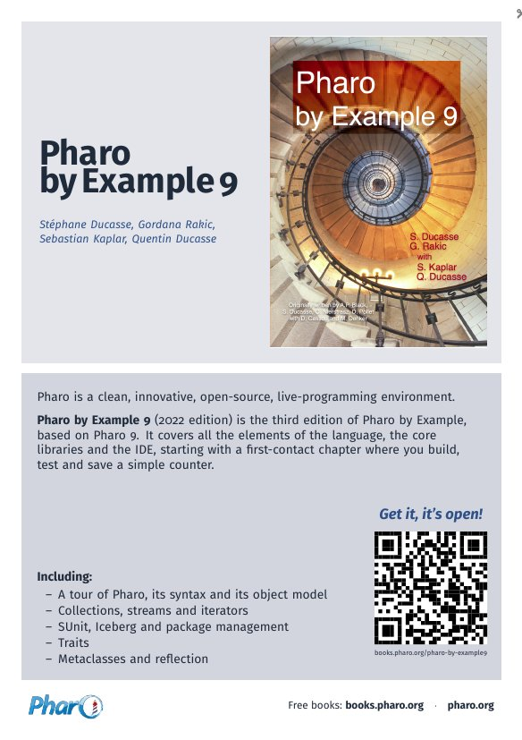</a><br>
  <b>Pharo by Example 9</b><br><sub><a href="BookFlyers/PBE9">BookFlyers/PBE9</a></sub>
</td>
<td align="center" width="33%">
  <a href="BookFlyers/LearningOOP/LearningOOP.pdf">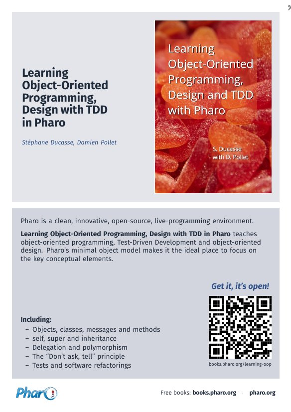</a><br>
  <b>Learning OOP, Design with TDD</b><br><sub><a href="BookFlyers/LearningOOP">BookFlyers/LearningOOP</a></sub>
</td>
<td align="center" width="33%">
  <a href="BookFlyers/WithStyle/WithStyle.pdf">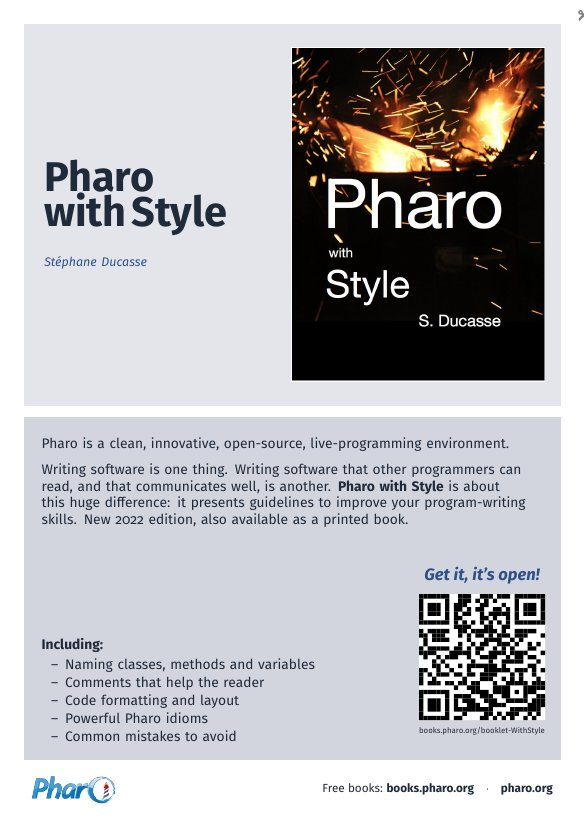</a><br>
  <b>Pharo with Style</b><br><sub><a href="BookFlyers/WithStyle">BookFlyers/WithStyle</a></sub>
</td>
</tr>
<tr>
<td align="center">
  <a href="BookFlyers/Testing/Testing.pdf">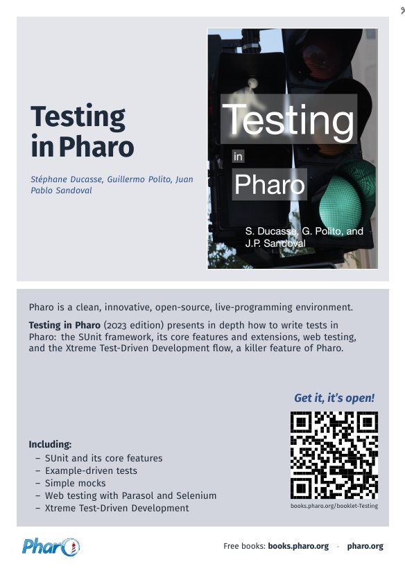</a><br>
  <b>Testing in Pharo</b><br><sub><a href="BookFlyers/Testing">BookFlyers/Testing</a></sub>
</td>
<td align="center">
  <a href="BookFlyers/Spec2/Spec2.pdf">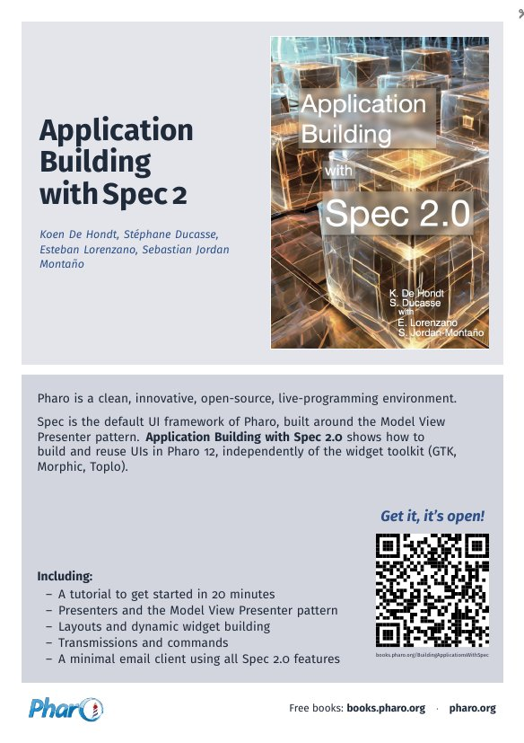</a><br>
  <b>Application Building with Spec 2</b><br><sub><a href="BookFlyers/Spec2">BookFlyers/Spec2</a></sub>
</td>
<td align="center">
  <a href="BookFlyers/ReflectiveKernel/ReflectiveKernel.pdf">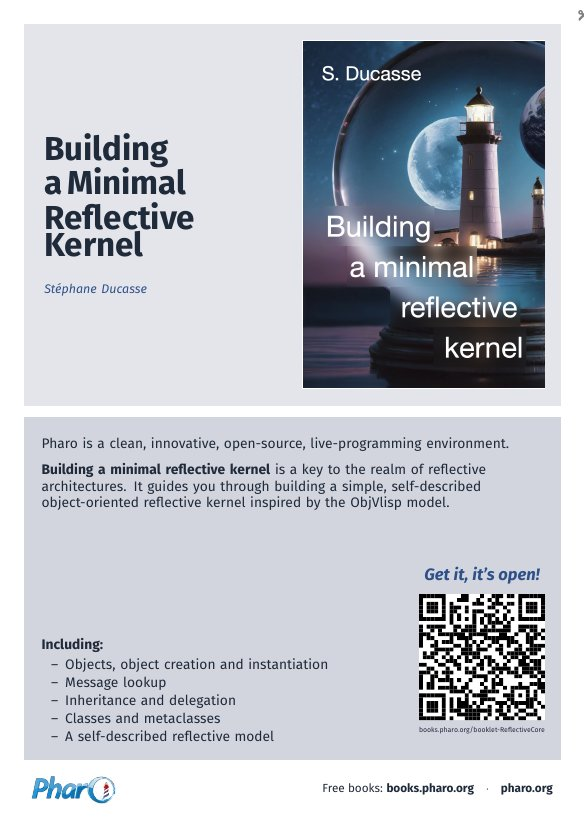</a><br>
  <b>Building a Minimal Reflective Kernel</b><br><sub><a href="BookFlyers/ReflectiveKernel">BookFlyers/ReflectiveKernel</a></sub>
</td>
</tr>
</table>

**Add a flyer for another book:** copy one of the folders, replace `figures/cover.*`, regenerate the QR code
(`qrencode -t SVG -m 0 -o qrcode.svg <url>` then `rsvg-convert -f pdf -o figures/qrcode.pdf qrcode.svg`)
and edit the title, authors, description and list in the `.tex`. The layout is shared in
[`BookFlyers/bookflyer.tex`](BookFlyers/bookflyer.tex).

---

## 🧾 Cheat sheet

A two-page, three-fold cheat sheet: syntax, collections, streams, the code browser, defining a class, and where to find help.

<table>
<tr>
<td align="center" width="50%">
  <a href="Flyers/pharo-flyers/pharoCheatSheet.pdf">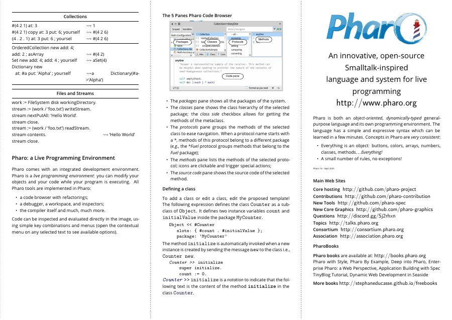</a>
</td>
<td align="center" width="50%">
  <a href="Flyers/pharo-flyers/pharoCheatSheet.pdf">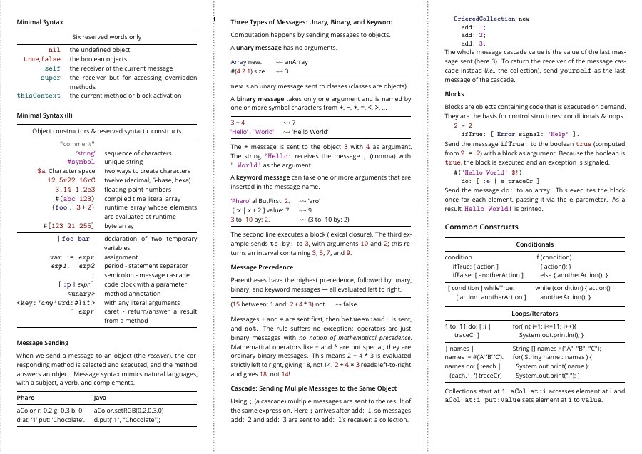</a>
</td>
</tr>
</table>

- 📄 PDF: [`Flyers/pharo-flyers/pharoCheatSheet.pdf`](Flyers/pharo-flyers/pharoCheatSheet.pdf) · ✏️ Source: [`pharoCheatSheet.tex`](Flyers/pharo-flyers/pharoCheatSheet.tex)
- Imported with its full history from the former `pharo-project/pharo-flyers` repository.

---

## 📰 Flyers

General flyers about Pharo, from the tri-fold LaTeX leaflet to earlier one-page versions.

<table>
<tr>
<td align="center" width="40%">
  <a href="Flyers/flyer/flyerpharopr.pdf">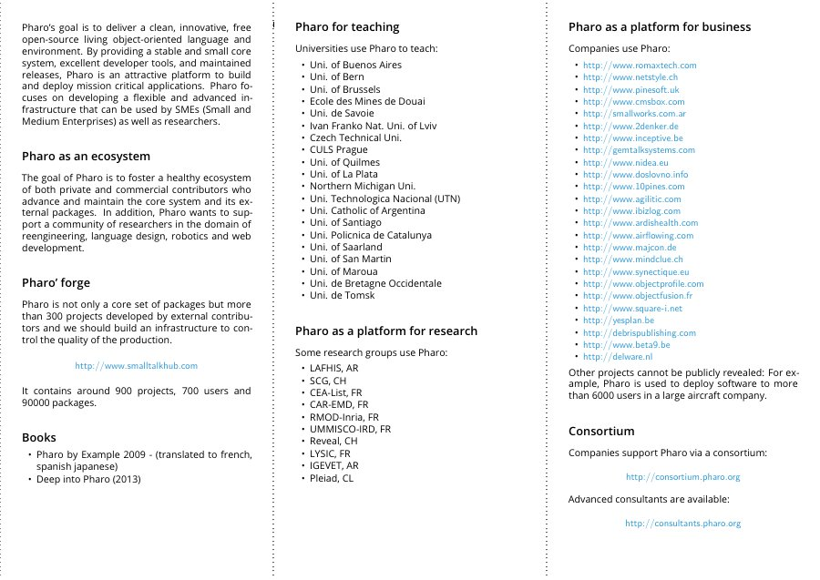</a><br>
  <b>Tri-fold flyer</b> (LaTeX)<br><sub><a href="Flyers/flyer">Flyers/flyer</a></sub>
</td>
<td align="center" width="30%">
  <a href="Flyers/Pharo.pdf">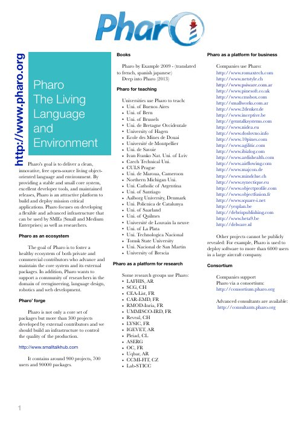</a><br>
  <b>The Living Language and Environment</b><br><sub>Pages / PDF</sub>
</td>
<td align="center" width="30%">
  <a href="Flyers/Pharo-April-2015.pdf">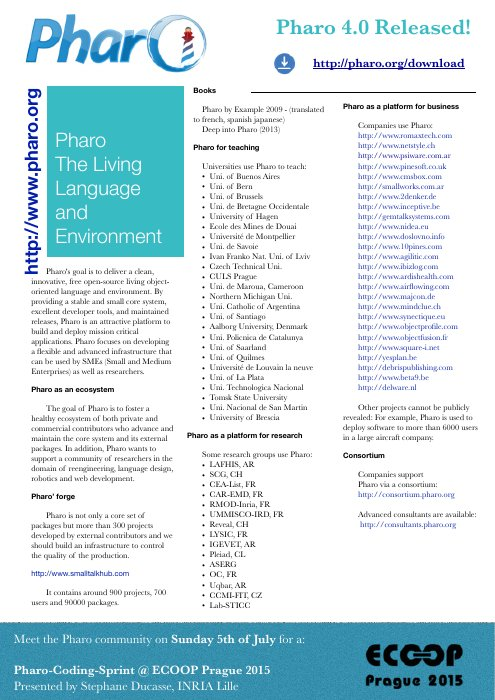</a><br>
  <b>April 2015 edition</b><br><sub>Pages / PDF</sub>
</td>
</tr>
</table>

Also in [`Flyers/`](Flyers): a business flyer draft (`PharoBusinessFlyer-v0.docx`) and the plain text of the flyer (`Pharo.txt`).

---

## 🎨 Logos

<table>
<tr>
<td align="center"><br><sub><a href="Logos/Pharo_Logo_v3.0.svg">Pharo_Logo_v3.0.svg</a></sub></td>
<td align="center"><br><sub><a href="Logos/Pharo_Icon_v3.0.svg">Pharo_Icon_v3.0.svg</a></sub></td>
<td align="center"><br><sub><a href="Logos/Pharo_Beacon_v3.0.svg">Pharo_Beacon_v3.0.svg</a></sub></td>
<td align="center"><br><sub><a href="Logos/icon-pharo.pdf">icon-pharo.pdf</a></sub></td>
</tr>
<tr>
<td align="center"><br><sub><a href="Logos/pharo-asso-logo.svg">pharo-asso-logo.svg</a></sub></td>
<td align="center"><br><sub><a href="Logos/pharo%20logo%20on%20the%20bottle%20by%201color_md.pdf">one-colour lighthouse</a></sub></td>
<td align="center"><br><sub><a href="Logos/pharo-with-url.png">pharo-with-url.png</a></sub></td>
<td align="center"><br><sub><a href="Logos/pharo.org.svg">pharo.org.svg</a></sub></td>
</tr>
</table>

Prefer the **SVG** files (vector, scale to any size). For LaTeX, convert them with `rsvg-convert -f pdf -o logo.pdf logo.svg`.

---

## 🛠 Building and contributing

All LaTeX documents compile with `pdflatex`, `lualatex` or `xelatex`. Documents drawn with a full-page TikZ overlay
(the poster and the book flyers) need **two runs**:

```bash
cd BookFlyers/Testing && pdflatex Testing && pdflatex Testing
```

LaTeX build files (`*.aux`, `*.log`, …) are ignored by git. The images in [`previews/`](previews) are only used by this README.

Ideas, corrections, translations and new material are very welcome: open an issue or a pull request.
Together, let's make the lighthouse shine further! 🗼
